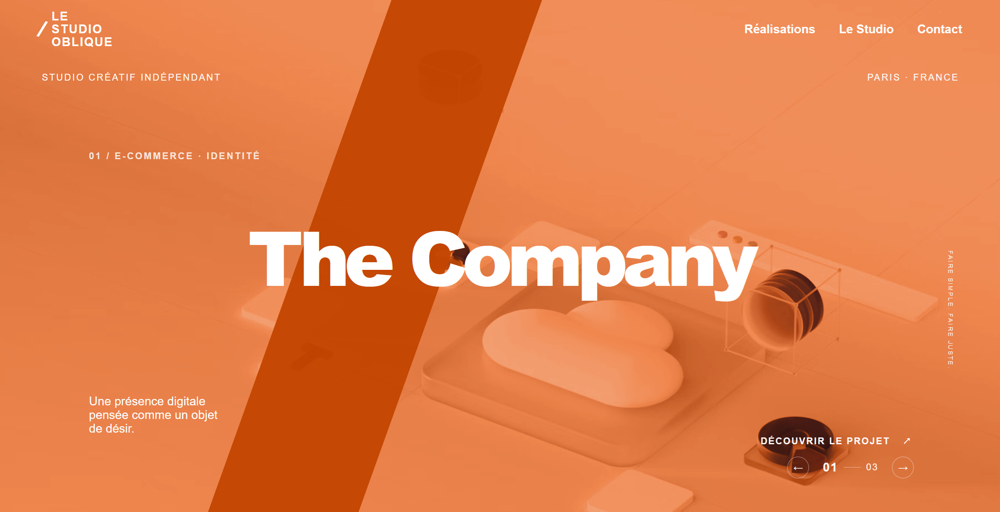

<div align="center">

# LE STUDIO OBLIQUE

**Studio Créatif Indépendant — Paris, France**

Identité de marque, direction artistique et expériences digitales.

_Maquette de démonstration._

[Voir le site en ligne](https://le-studio-oblique.vercel.app/)


</div>

---

## Aperçu

<div align="center">



</div>

---

## À propos

Site vitrine du **Studio Oblique**, construit avec **Next.js (App Router)** et **TypeScript**.
Le design repose sur une identité forte : une barre diagonale colorée, une typographie imposante et un slider de projets plein écran.

## Fonctionnalités

- Slider de projets plein écran avec transitions de couleur (orange, bleu, vert)
- Design responsive : desktop, tablette et mobile
- Bouton "retour en haut" avec effet au survol et au toucher
- Pages Réalisations, Studio et Contact
- Navigation fluide (smooth scroll)

## Pages

| Route      | Description  |
| ---------- | ------------ |
| `/`        | Réalisations |
| `/studio`  | Le Studio    |
| `/contact` | Contact      |

## Technologies

- [Next.js 16](https://nextjs.org/) (App Router, Turbopack)
- [React 19](https://react.dev/)
- [TypeScript](https://www.typescriptlang.org/)
- CSS global avec variables (`globals.css`)
- Polices Google Fonts : DM Sans et Manrope

## Démarrage

Prérequis : **Node.js 18.17** ou supérieur.

```bash
# Installer les dépendances
npm install

# Lancer en développement
npm run dev
```

Ouvrir [http://localhost:3000](http://localhost:3000).

## Production

```bash
npm run build
npm start
```

## Structure du projet

```
le-studio-oblique/
├── app/
│   ├── contact/page.tsx
│   ├── studio/page.tsx
│   ├── globals.css
│   ├── layout.tsx
│   └── page.tsx
├── components/
│   ├── ProjectSlider.tsx
│   ├── ScrollUp.tsx
│   ├── SiteFooter.tsx
│   └── SiteHeader.tsx
├── public/
│   └── apercu.png
└── package.json
```

## Avant la mise en ligne

- [ ] Remplacer les photos Unsplash par les visuels définitifs
- [ ] Remplacer `bonjour@lestudio.oblique` par l'adresse réelle
- [ ] Remplacer le formulaire `mailto` par une API ou un service de formulaire
- [ ] Ajouter les liens réels Instagram et LinkedIn
- [ ] Ajouter les mentions légales et la politique de confidentialité

> Les polices Google Fonts et les photos externes nécessitent une connexion internet.

## Liens

| Ressource | Lien                                                          |
| --------- | ------------------------------------------------------------- |
| Site      | [VOTRE-URL.vercel.app](https://le-studio-oblique.vercel.app/) |
| Créateur  | [David R](https://github.com/Dravix89)                        |

## Auteur

**David Roussety** — Créateur & Développeur Web

---

<div align="center">

© 2026 Le Studio Oblique — Tous droits réservés

</div>
